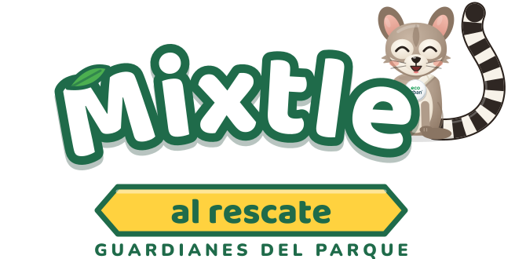
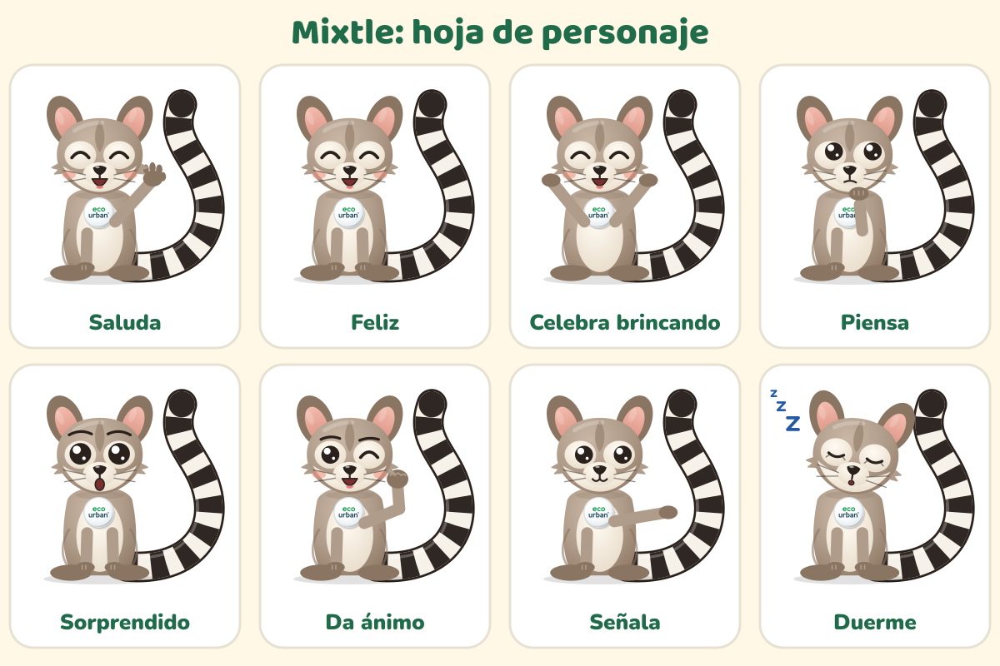
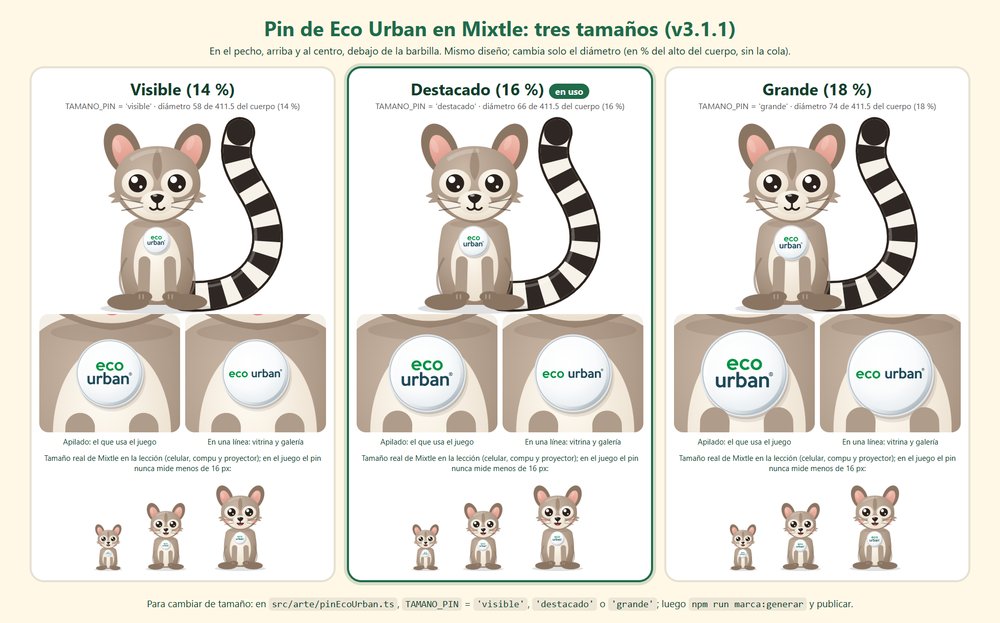
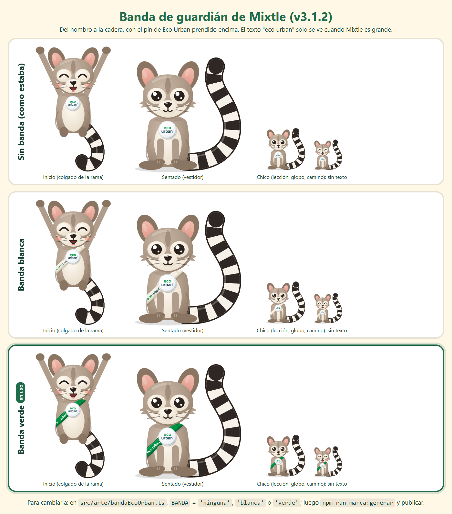

# Marca de "Mixtle al rescate"

Mini guía para quien haga materiales del juego (Eco Urban, maestras y maestros, diseño). Dirección visual elegida: **A · Parque de día**.

## Logo

- **Archivos:** `public/marca/logo.svg` (y la copia `docs/marca/logo.svg`). Es SVG puro: las letras están convertidas en trazos, así que se ve igual en cualquier computadora, aunque no tenga las fuentes.
- **Partes:** "Mixtle" en arco (blanco con borde verde y una sombra suave), Mixtle sentado al final de la palabra, el listón amarillo "al rescate" y el lema **"Guardianes del parque"**.
- **Sin Mixtle:** cuando Mixtle ya está en la escena (por ejemplo, en el inicio), se usa la versión sin él (`logoSvg({ sinMixtle: true })`), para no tener dos Mixtle.
- **Espacio libre:** alrededor del logo, al menos la altura del listón. Tamaño mínimo: 240 px de ancho en pantalla, 5 cm impreso.
- **Ícono de la app:** la cabeza de Mixtle sobre un círculo de cielo con fondo verde (`public/favicon.svg` y `public/iconos/`). La versión "maskable" deja la cara dentro de la zona segura de Android.
- **Cómo se regenera:** `npm run marca:generar` vuelve a hacer las letras en trazos, el logo, el favicon, los íconos PNG y la hoja de personaje. Una prueba (`tests/marca.test.ts`) avisa si quedaron desfasados.

**No:** cambiar los colores del logo, estirarlo, ponerle contorno o sombra extra, girarlo, ponerlo sobre fondos oscuros u ocupados sin su recuadro claro, o escribir "Mixtle" con otra letra en su lugar.

## Colores

| Nombre | Hex | Uso |
|---|---|---|
| Verde bosque | `#1F6B4A` | Marca, bordes del logo, botones de sistema |
| Verde noche | `#123D2B` | Sombras y textos sobre claro |
| Sol | `#FFD23F` | Acentos, listón, racha, estampas |
| Naranja barro | `#B84A14` | Botón principal ("¡Jugar!", "¡Sigamos!") |
| Cielo | `#D3EEF9` | Fondos |
| Crema | `#FFF8E7` | Tarjetas y papel |
| Hoja | `#4CAF50` | Hojitas y detalles de naturaleza |

Contraste medido (WCAG 2.x): blanco sobre naranja barro 5.21:1, verde bosque sobre blanco 6.44:1, tinta `#1D2B24` sobre sol 10.22:1, blanco sobre verde bosque 6.44:1. Todos pasan AA. Cada unidad tiene además su color propio en el camino (todos con contraste AA para texto blanco).

## Tipografía

- **Baloo 2 ExtraBold** para títulos y botones grandes (OFL 1.1).
- **Nunito** 700, 800 y 900 para todo lo demás (OFL 1.1).
- Las dos vienen dentro de la app (`@fontsource`), así que el juego funciona sin internet. En materiales impresos se pueden descargar de Google Fonts.

## Mixtle

**Quién es.** Mixtle es un cacomixtle joven que vive en un parque de Toluca. Los cacomixtles son animales reales del centro de México: esbeltos, de orejas grandes, con anillos claros alrededor de los ojos y una cola larga con anillos blancos y negros. Mixtle es un personaje original de este proyecto, dibujado a partir del animal real, sin parecido con personajes con derechos de autor.

**Personalidad.** Curioso, valiente y un poco despistado. Le encanta trepar árboles. Como buen cacomixtle, de noche anda despierto, y a veces se le ve dormido de día. Nunca presume: el héroe es el grupo, y él lo acompaña. Celebra el esfuerzo, no solo el acierto.

**Su frase:** **"¡Al rescate!"**. La dice al empezar a jugar y en los momentos de premio.

**Las 8 poses** (claves de arte `mixtle-<pose>`):

| Pose | Cuándo se usa |
|---|---|
| Saluda (`saluda`) | Bienvenidas, al entrar al camino |
| Feliz (`feliz`) | Después de un acierto, en el logo |
| Celebra brincando (`celebrando`) | Fin de lección, cofre, estampa nueva |
| Piensa (`pensando`) | Pistas ("¡Casi!"), lecciones bloqueadas |
| Sorprendido (`sorprendido`) | Un cofre nuevo, preguntar si salir |
| Da ánimo (`animo`) | "¡Vamos!": a la mitad de la lección, al reintentar |
| Señala (`senalando`) | Indicar la siguiente parada o la consigna |
| Duerme (`duerme`) | Modo vitrina en pausa y pantallas de espera |

**En reposo** Mixtle nunca está congelado: parpadea, mueve las orejas de vez en cuando y su cola se mece. Con "animaciones suaves" (modo facilitador) o con el movimiento reducido del sistema, deja de mover las orejas y se calma la cola.

## El pin de Eco Urban y el uso de su logotipo

Desde la v3.1, Mixtle trae en el pecho un pin con el logotipo de Eco Urban. Es parte fija del personaje: no es un accesorio del vestidor y no se puede quitar. En la v3.1.1 se cambió de lugar y de tamaño para que se vea.

- **El logotipo** es el de Eco Urban A.C., calcado en trazos de su archivo: `scripts/marca/trazar-eco-urban.py` genera `src/arte/ecoUrban.generado.ts` y coincide con el original en 98.4 % (verde) y 98.6 % (azul) de los píxeles. Los colores vienen del mismo archivo: verde **#009345** y azul petróleo **#1E4959**. No se deforma, no se le cambian los colores y no se le pone nada encima: ni sombras, ni brillos, ni contornos.
- **El botón:** blanco y abombado, con un borde gris muy claro para que no se pierda sobre la panza, un brillo en la orilla y una sombra suave sobre el pelaje.
- **Dónde va:** en el pecho, arriba y al centro, sobre la parte clara, justo debajo de la barbilla. Los brazos se dibujan encima. Cuando uno cruza el pecho le tapa una orilla, y siempre se ve al menos el 70 %. El peor caso es "pensando", con la mano en la barbilla: se ve el 74.5 %. Colgado de la rama, en el inicio, se ve completo.
- **Encima de los accesorios:** va siempre por arriba del paliacate y de cualquier cosa del vestidor, como prendido a la tela.
- **Tamaño:** "destacado", con un diámetro del 16 % del alto del cuerpo, sin la cola. Las otras dos opciones son "visible" (14 %) y "grande" (18 %). Se cambia con un solo valor, `TAMANO_PIN` en `src/arte/pinEcoUrban.ts`. Después se corre `npm run marca:generar` y se publica. En pantalla, el pin nunca mide menos de 16 px. Solo en las fichas del tamaño de un ícono (el encabezado y el nombre del grupo en el camino) va a su escala.
- **Dos acomodos del logotipo:** el **apilado** pone "eco" sobre "urban" y es el que se lee al tamaño real del juego, así que lo usa Mixtle en todas partes. El de **una línea** es como lo usa Eco Urban, pero sus letras miden 0.6 veces las del apilado: solo se usa donde el pin mide unos 60 px o más (vitrina, galería, documentos).
- **El ícono de la app** lleva el pin prendido abajo a la derecha. **El favicon de la pestaña** no lo lleva, porque a 16 px sería una mancha.
- **Dónde revisarlo:** la página `?mixtle` tiene la sección "Pin Eco Urban", con el pin solo, sus dos acomodos, Mixtle en cada pose y los tres tamaños.

### La banda de guardián (v3.1.2)

Mixtle trae una banda cruzada en el torso, del hombro izquierdo a la cadera derecha, como la de un guardaparques ("Guardianes del parque"). Lleva "eco urban" escrito y el pin prendido encima, en el pecho.

- **En uso: la verde** (#009345, con el logotipo en blanco), desde la v3.1.3. Hay también una blanca (blanco hueso con el logotipo a todo color) y la opción de no llevarla. Se cambia con un solo valor: `BANDA` en `src/arte/bandaEcoUrban.ts` (`'ninguna'`, `'blanca'` o `'verde'`). Después se corre `npm run marca:generar` y se publica.
- **El texto sigue la inclinación** de la banda (42°) sin estirarse. Mide 10 de las 440 unidades del cuerpo: es lo más grande que cabe sin que lo tape un brazo, la cabeza o el pin. Queda libre en 11 de las 12 poses. En "celebrando" el brazo levantado cruza la banda, y ahí va sin texto.
- **El texto solo se ve cuando Mixtle es grande:** con el cuerpo de 250 px o más, donde el logotipo mide 5.7 px o más (inicio y vestidor en una laptop de 1366×768, proyector, vitrina). Más chico (lección, globo, camino, selección de grupo, diploma) va solo la tela de la banda con el pin, para que no quede una mancha.
- **Convive con los accesorios:** el paliacate y la mochila van encima de la banda y la capa por detrás. Ninguno tapa el texto.
- **El ícono de la app y el de la pestaña** no la llevan: se quedan como estaban.

**La marca de Eco Urban en las pantallas** (v3.1.2). Es solo el logotipo "eco urban", sin texto que lo acompañe, como una marca de agua discreta. Va a todo color y sin deformar, sobre una pastilla blanca semitransparente, pegada a una esquina con un margen pequeño. Mide 14 px de alto en celular, 20 px en una laptop de 1366×768 y 22 px como mucho. Es un solo componente (`MarcaEcoUrban`) y se ve igual en todas las pantallas. No se puede tocar ni es un enlace, y no va dentro de las lecciones:

| Pantalla | Dónde |
|---|---|
| Pantalla de carga | Abajo a la derecha. En `index.html` reutiliza con `<use>` el logotipo del pin del logo, así que no pesa el doble. |
| Inicio (Mixtle colgado de la rama) | Arriba a la izquierda, sobre la copa del árbol. Abajo a la derecha está la ardilla (en el celular se encimaban) y abajo a la izquierda, el aviso "Toca la pantalla para escuchar". |
| ¿Quién va a jugar? | Abajo a la derecha (abajo a la izquierda está Mixtle). |
| Camino de unidades | Abajo a la izquierda, fija. Las paradas del camino nunca llegan a esa esquina y lo último del camino sube por encima de ella. |
| Diploma (en pantalla e impreso) | Abajo, al centro del pie, entre la fecha y la firma de Mixtle. |

El logotipo de Eco Urban es propiedad de Eco Urban A.C. y se usa con su autorización. Para usarlo en otro lugar, hay que pedir permiso a Eco Urban.

## Tono de Mixtle

- Habla al grupo, de "ustedes": "¡Lo lograron!", "Toquen la lección que señalo".
- Frases cortas, de una idea, en español de México, que se entienden al oírlas (las niñas y los niños de 6 años todavía no leen con soltura).
- Ante un error dice **"¡Casi!"** y da una pista. Nunca "mal", "incorrecto" ni nada que regañe.
- Celebra el esfuerzo ("¡Practicando, cada vez les sale mejor!") y nunca compara grupos.
- Nada de presión: no hay prisa, ni cuentas regresivas, ni "si no juegas pierdes".
